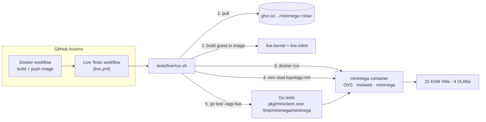
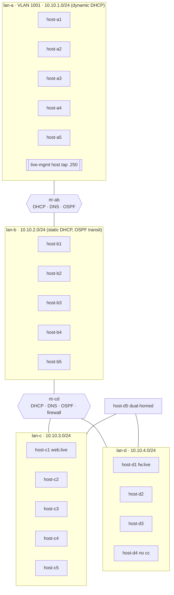

# minimega live integration tests

End-to-end tests that run minimega the way it is deployed in practice — from
the published Docker image — boot a real KVM experiment, and drive it over the
command socket the way phēnix does. They answer one question: **does a change
to minimega still run a working experiment?**

Unit tests (`scripts/test.bash`) and minitest (`tests/*.want`) stay as they
are. These tests sit on top and need a Linux host with KVM.

## What runs



1. **Image** — CI tests the exact image the Docker workflow just built
   (the immutable short-SHA tag on pushes; a `docker save` artifact on pull
   requests, which cannot push).
2. **Guest image** — `image/build.sh` runs *inside that image* and packs a
   stock Ubuntu kernel with a ~15 MB busybox initramfs containing the
   image's own `miniccc`, `minirouter`, and `protonuke`, plus `bird`,
   `dnsmasq`, and `iptables` for routers. It boots in seconds and needs
   160–256 MB of RAM, so 22 VMs fit on a standard runner.
3. **Deployment** — the container starts with the flags from
   `docker/README.md` (privileged, `/dev`, `/lib/modules`, `/tmp/minimega`).
4. **Topology** — `topology.mm` is loaded with `mm read`, exercising the CLI
   and script path used by people and FIREWHEEL.
5. **Tests** — Go tests (`//go:build live`) talk to the bind-mounted socket
   with `pkg/miniclient`, the integration path phēnix uses.

## Topology



| Group | VMs | What it exercises |
|---|---|---|
| Routers | `rtr-ab`, `rtr-cd` | minirouter: interfaces, DHCP ranges and static leases, DNS records, OSPF (bird), `fw` (iptables), `rid`, `schedule` |
| lan-a | `host-a1..a5` | dynamic leases, range launch (`host-a[2-5]`), `serial-ports`, `virtio-ports`, `colocate`, host tap |
| lan-b | `host-b1..b5` | static MACs, `e1000` vs `virtio-net-pci`, `vcpus`/`cores` |
| lan-c | `host-c1..c5` | `disk create`, virtio/IDE disks, cache mode, snapshot isolation, `qemu-append`, `machine q35`, `usb-use-xhci`, `vga cirrus` |
| lan-d | `host-d1..d5` | firewall target, `backchannel false`, dual-homed NICs, fixed `uuid` |

Every VM shares one saved configuration (`vm config save live-base`), launches
through the namespace queue (`ns queueing true` + `vm launch`), and is started
with `vm start all`.

## What is tested

`TestLive` runs ordered phases. Gate phases (version, namespace, inventory, cc,
DHCP) skip everything after them when they fail, so one root cause produces one
failure.

| Area | Checks |
|---|---|
| Control plane | `version`, `check`, `host`, `namespace`, `ns hosts/queue/queueing`, `vm info`, `vm info summary`, `vlans`, `bridge` + OVS port/VLAN tags, `file list`, `disk info/snapshot`, miniweb (`/`, `/vms/info.json`) |
| Boot | all 22 VMs `RUNNING`, 21 miniccc clients, every expected address learned from tap snooping |
| Command and control | `cc exec` (one, all, tag and column filters), `cc exitcode`, `cc send`/`recv`, `cc background`, `cc process list/kill`, `cc responses`, `cc delete` |
| Guest view of config | SMBIOS serial from `qemu-append`, VM UUID, disk sizes per interface, snapshot isolation, Q35 vs i440FX, xHCI, SMP, NIC driver and MAC, dual-homed addressing |
| Networking | same-LAN ping, OSPF routes, cross-router ping and traceroute, no-cc host reachable, DNS, HTTP to protonuke, firewall drop vs control, host tap (both directions), QoS delay and loss, `capture pcap` |
| VM operations | `vm screenshot` (std and cirrus), `vm serial`, `vm qmp`, `vnc record`, `vm tag` + tag filter, `vm top`, `vm stop/start`, `vm net disconnect/connect`, `vm hotplug add/remove`, `vm save`, `vm kill` + `vm flush` + `vm config clone` + queued relaunch |
| Teardown | `clear namespace` removes VMs, QEMU processes, and OVS ports |

Out of scope: containers, Android, bare-metal VMs, and multi-node meshes.

## Running locally

Needs Linux, root, Docker, `/dev/kvm`, the `openvswitch` kernel module, and Go.

```bash
# test the image CI publishes for master
sudo tests/live/run.sh ghcr.io/sandia-minimega/minimega:master

# test a local build
docker build -t minimega:dev -f docker/Dockerfile .
sudo LIVE_PULL=0 tests/live/run.sh minimega:dev

# run a subset and keep the experiment up to poke at it
sudo LIVE_KEEP=1 LIVE_TEST_ARGS='-test.run TestLive/(Version|Namespace|Inventory|CCClients|DHCP|DNS)$' \
  tests/live/run.sh minimega:dev
docker exec minimega mm namespace live vm info
```

`run.sh` refuses to replace an existing `minimega` container or
`/tmp/minimega` unless `LIVE_FORCE=1` is set. Results land in
`./live-artifacts`: the test log, a Markdown summary, minimega and container
logs, diagnostics (`vm info`, routers, OVS), cc responses, screenshots, and a
pcap.

## Changing the tests

- Add a phase by writing a `func(t *testing.T)` in `live_test.go` and adding
  it to the `phases` list. Use `ccOK`/`ccEventually` for guest commands and
  `eventually` for anything asynchronous.
- If you change `topology.mm`, update `topology_test.go` to match.
- Validate syntax without a deployment: `minimega -e read topology.mm check`.
- Compile check: `GOFLAGS=-mod=vendor go vet -tags live ./tests/live`.
